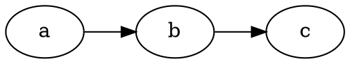
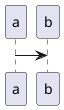

# Markdown 图表客户端矩阵 Implementation Plan（spec §2.1–2.4/§2.6）

> **For agentic workers:** REQUIRED SUB-SKILL: Use superpowers:subagent-driven-development (recommended) or superpowers:executing-plans to implement this plan task-by-task. Steps use checkbox (`- [ ]`) syntax for tracking.

**Goal:** 图表渲染从「仅 mermaid 硬编码」升级为注册表驱动的多语言矩阵：graphviz/nomnoml 本地引擎、全语言 kroki 远程通道与源码模式、math 围栏、图/源码切换、mermaid 主题联动、按语言模式设置。

**Architecture:** `packages/render-text/src/markdown/diagrams.ts`（注册表+kroki 编码）与 `diagramEngines.ts`（本地引擎适配）为纯模块；`pipeline.ts` 的 diagrams 步重写为查表分发；app 侧经 `setDiagramOptions` 注入 krokiHost/modeOf/mermaidTheme（沿用 setMarkdownBackend 注入模式）；外观切换经 `vv:appearance-applied` 文档事件驱动各实例重渲染 mermaid。

**Tech Stack:** markdown-it 管线既有五步架构、@viz-js/viz（standalone wasm）、nomnoml、pako（kroki deflate）、vitest/jsdom、playwright。

**Spec:** `docs/superpowers/specs/2026-10-19-markdown-markpad-alignment-design.md` §2（本计划实现 §2.1–2.4 与 §2.6；§2.5 服务端路径另立计划）

## Global Constraints

- 启用集（spec §2.6 预算裁决）：**本期安装本地引擎仅 @viz-js/viz + nomnoml**；bpmn/vega/vegalite/excalidraw 注册表 `local:false`（默认 kroki 覆盖），后续按需加装——预算门禁 ≤4MB 锚定此集。
- mermaid 维持 ^12.1.0（spec 勘误已订正），渲染不设 `securityLevel:'loose'`（保持默认 strict，与现状一致）。
- kroki 默认 host `https://kroki.io`；kroki `` 由管线在**净化后**创建，不经 sanitize（spec §2.2 的「sanitize 动态源放行」经核实不需要——文档勘误随本计划提交）。
- 管线单步容错契约不变：diagrams 步单块失败保留源码+错误样式，绝不抛出中断文档。
- 所有新类名走 `cls(ctx, …)` 前缀机制（CLS 表扩展）；CSS 落 `apps/web/src/app.css` 的 `.vv-markdown` 作用域。
- 测试一律在**仓库根**跑 vitest（包目录缺 jsdom）；e2e 重建一律 `pnpm --filter web build:e2e`（裸 build 冲掉 CDN 注入）。
- 每任务原子提交，Angular 规范中文 message。

---

### Task 1: 图表注册表与 kroki 编码

**Files:**
- Modify: `packages/render-text/package.json`（加 pako）
- Create: `packages/render-text/src/markdown/diagrams.ts`
- Create: `packages/render-text/src/markdown/diagrams.test.ts`
- Modify: `packages/render-text/package.json` exports 加 `"./markdown/diagrams": "./src/markdown/diagrams.ts"`

**Interfaces:**
- Produces: `resolveDiagramType(lang: string): DiagramType | null`、`DIAGRAM_TYPES: readonly DiagramType[]`、`DiagramMode = 'local'|'kroki'|'source'`、`DEFAULT_KROKI_HOST = 'https://kroki.io'`、`createKrokiUrl(host: string, krokiType: string, source: string): string`、`DiagramType { id; aliases: readonly string[]; local: boolean; defaultMode: DiagramMode; krokiType: string; highlightLang: string; engine?: 'mermaid'|'graphviz'|'nomnoml'|'math' }`——Task 2/3/6/7 依赖。

- [ ] **Step 1: 写失败测试**

```ts
// packages/render-text/src/markdown/diagrams.test.ts
import { describe, expect, it } from 'vitest';
import { inflateSync } from 'node:zlib';
import { DIAGRAM_TYPES, DEFAULT_KROKI_HOST, createKrokiUrl, resolveDiagramType } from './diagrams';

describe('resolveDiagramType', () => {
  it('主名命中（大小写归一）', () => {
    expect(resolveDiagramType('Mermaid')?.id).toBe('mermaid');
    expect(resolveDiagramType('graphviz')?.id).toBe('graphviz');
  });
  it('别名命中：dot/vega-lite/latex', () => {
    expect(resolveDiagramType('dot')?.id).toBe('graphviz');
    expect(resolveDiagramType('vega-lite')?.id).toBe('vegalite');
    expect(resolveDiagramType('latex')?.id).toBe('math');
  });
  it('空与非图表语言返回 null', () => {
    expect(resolveDiagramType('')).toBeNull();
    expect(resolveDiagramType('rust')).toBeNull();
  });
  it('注册表覆盖 spec 11+1 类', () => {
    for (const id of ['mermaid','graphviz','plantuml','c4plantuml','ditaa','blockdiag','nwdiag','actdiag','seqdiag','erd','pikchr','svgbob','excalidraw','nomnoml','bpmn','vega','vegalite','math']) {
      expect(resolveDiagramType(id), id).not.toBeNull();
    }
  });
  it('本期 local 启用集 = mermaid/graphviz/nomnoml/math，其余 kroki 兜底', () => {
    const localIds = DIAGRAM_TYPES.filter((t) => t.local).map((t) => t.id).sort();
    expect(localIds).toEqual(['graphviz', 'math', 'mermaid', 'nomnoml']);
    expect(resolveDiagramType('vega')!.defaultMode).toBe('kroki');
  });
});

describe('createKrokiUrl', () => {
  it('默认 host 与 URL 形态', () => {
    const url = createKrokiUrl('', 'graphviz', 'digraph{}');
    expect(url.startsWith(`${DEFAULT_KROKI_HOST}/graphviz/svg/`)).toBe(true);
  });
  it('host 尾斜杠归一', () => {
    const url = createKrokiUrl('https://k.example.com/', 'dot', 'x');
    // krokiType 由调用方传归一名；host 尾斜杠剥离
    expect(url.startsWith('https://k.example.com/dot/svg/')).toBe(true);
  });
  it('base64url 编码可解码还原（deflate 往返）', () => {
    const source = 'digraph { a -> b }';
    const url = createKrokiUrl(DEFAULT_KROKI_HOST, 'graphviz', source);
    const b64 = url.split('/svg/')[1]!;
    const std = b64.replace(/-/g, '+').replace(/_/g, '/');
    const bin = Buffer.from(std, 'base64');
    expect(inflateSync(new Uint8Array(bin)).toString()).toBe(source);
  });
});
```

- [ ] **Step 2: 跑测试确认失败**

Run: `pnpm vitest run packages/render-text/src/markdown/diagrams.test.ts`
Expected: FAIL（模块不存在）

- [ ] **Step 3: 实现 diagrams.ts**

```ts
// diagrams.ts — 图表注册表与 kroki 编码（spec 2026-10-19 §2.1/§2.2）。
// 类型清单/别名对齐 markpad src/lib/diagrams.ts；local 启用集按 spec §2.6
// 预算裁决仅 graphviz/nomnoml（mermaid/math 既有），其余 kroki/源码覆盖。
import pako from 'pako';

export type DiagramMode = 'local' | 'kroki' | 'source';

export interface DiagramType {
  id: string;
  aliases: readonly string[];
  /** 本期是否内置本地引擎依赖（Global Constraints 启用集） */
  local: boolean;
  defaultMode: DiagramMode;
  /** kroki 服务端类型名；'' = kroki 不支持（如 math） */
  krokiType: string;
  /** 源码模式/图源切换的高亮语言（'' = 不高亮） */
  highlightLang: string;
  engine?: 'mermaid' | 'graphviz' | 'nomnoml' | 'math';
}

export const DIAGRAM_TYPES: readonly DiagramType[] = [
  { id: 'mermaid', aliases: [], local: true, defaultMode: 'local', krokiType: 'mermaid', highlightLang: 'mermaid', engine: 'mermaid' },
  { id: 'graphviz', aliases: ['dot'], local: true, defaultMode: 'local', krokiType: 'graphviz', highlightLang: 'dot', engine: 'graphviz' },
  { id: 'plantuml', aliases: [], local: false, defaultMode: 'kroki', krokiType: 'plantuml', highlightLang: 'plantuml' },
  { id: 'c4plantuml', aliases: [], local: false, defaultMode: 'kroki', krokiType: 'c4plantuml', highlightLang: 'plantuml' },
  { id: 'ditaa', aliases: [], local: false, defaultMode: 'kroki', krokiType: 'ditaa', highlightLang: '' },
  { id: 'blockdiag', aliases: [], local: false, defaultMode: 'kroki', krokiType: 'blockdiag', highlightLang: '' },
  { id: 'nwdiag', aliases: [], local: false, defaultMode: 'kroki', krokiType: 'nwdiag', highlightLang: '' },
  { id: 'actdiag', aliases: [], local: false, defaultMode: 'kroki', krokiType: 'actdiag', highlightLang: '' },
  { id: 'seqdiag', aliases: [], local: false, defaultMode: 'kroki', krokiType: 'seqdiag', highlightLang: '' },
  { id: 'erd', aliases: [], local: false, defaultMode: 'kroki', krokiType: 'erd', highlightLang: '' },
  { id: 'pikchr', aliases: [], local: false, defaultMode: 'kroki', krokiType: 'pikchr', highlightLang: '' },
  { id: 'svgbob', aliases: [], local: false, defaultMode: 'kroki', krokiType: 'svgbob', highlightLang: '' },
  { id: 'excalidraw', aliases: [], local: false, defaultMode: 'kroki', krokiType: 'excalidraw', highlightLang: 'json' },
  { id: 'nomnoml', aliases: [], local: true, defaultMode: 'local', krokiType: 'nomnoml', highlightLang: '', engine: 'nomnoml' },
  { id: 'bpmn', aliases: [], local: false, defaultMode: 'kroki', krokiType: 'bpmn', highlightLang: 'xml' },
  { id: 'vega', aliases: [], local: false, defaultMode: 'kroki', krokiType: 'vega', highlightLang: 'json' },
  { id: 'vegalite', aliases: ['vega-lite'], local: false, defaultMode: 'kroki', krokiType: 'vegalite', highlightLang: 'json' },
  { id: 'math', aliases: ['latex'], local: true, defaultMode: 'local', krokiType: '', highlightLang: 'latex', engine: 'math' }
];

const byId = new Map<string, DiagramType>();
for (const t of DIAGRAM_TYPES) {
  byId.set(t.id, t);
  for (const a of t.aliases) byId.set(a, t);
}

/** fence 语言 → 图表类型（小写归一；空串/非图表语言 null）。 */
export function resolveDiagramType(lang: string): DiagramType | null {
  const l = lang.trim().toLowerCase();
  return l ? (byId.get(l) ?? null) : null;
}

export const DEFAULT_KROKI_HOST = 'https://kroki.io';

/** kroki URL：pako deflate(level 9) + base64url（无填充）。host 尾斜杠归一。 */
export function createKrokiUrl(host: string, krokiType: string, source: string): string {
  const base = (host || DEFAULT_KROKI_HOST).replace(/\/+$/, '');
  const bytes = pako.deflate(new TextEncoder().encode(source), { level: 9 });
  let str = '';
  for (let i = 0; i < bytes.length; i += 1) str += String.fromCharCode(bytes[i]!);
  const b64 = btoa(str).replace(/\+/g, '-').replace(/\//g, '_').replace(/=+$/, '');
  return `${base}/${krokiType}/svg/${b64}`;
}
```

`packages/render-text/package.json`：dependencies 加 `"pako": "^2.1.0"`（devDependencies 加 `"@types/pako": "^2.0.3"`）；exports 加 `"./markdown/diagrams": "./src/markdown/diagrams.ts"`。安装：`pnpm add --filter @vviewer/render-text pako@^2.1.0 && pnpm add -D --filter @vviewer/render-text @types/pako@^2.0.3`。

- [ ] **Step 4: 跑测试确认通过**

Run: `pnpm vitest run packages/render-text/src/markdown/diagrams.test.ts`
Expected: PASS

- [ ] **Step 5: Commit**

```bash
git add packages/render-text/package.json pnpm-lock.yaml packages/render-text/src/markdown/diagrams.ts packages/render-text/src/markdown/diagrams.test.ts
git commit -m "feat(md): 图表注册表与 kroki 编码——18 类型/别名归一/base64url 往返锚"
```

---

### Task 2: 本地引擎适配器

**Files:**
- Modify: `packages/render-text/package.json`（加 @viz-js/viz、nomnoml）
- Create: `packages/render-text/src/markdown/diagramEngines.ts`
- Create: `packages/render-text/src/markdown/diagramEngines.test.ts`

**Interfaces:**
- Consumes: Task 1 `DiagramType['engine']` 键。
- Produces: `renderDiagramEngine(engine: 'mermaid'|'graphviz'|'nomnoml'|'math', source: string, opts?: { mermaidTheme?: 'default'|'dark' }): Promise<string>`（返回 SVG/HTML 字符串；失败 reject）——Task 3 依赖。mermaid 序号与 ensureMermaid 也导出：`renderMermaidInto(container: Element, source: string, theme: 'default'|'dark'): Promise<boolean>`（Task 5 依赖）。

- [ ] **Step 1: 写失败测试**

```ts
// packages/render-text/src/markdown/diagramEngines.test.ts
import { describe, expect, it } from 'vitest';
import { renderDiagramEngine } from './diagramEngines';

// 真渲染（wasm/纯 JS 引擎在 node/jsdom 可运行）；个别环境缺能力时 skipIf 兜底，
// 失败语义（reject）单测不依赖真渲染。
const canViz = await import('@viz-js/viz').then(() => true, () => false);
const canNomnoml = await import('nomnoml').then(() => true, () => false);

describe('renderDiagramEngine', () => {
  it.skipIf(!canViz)('graphviz 渲染含 <svg', async () => {
    const html = await renderDiagramEngine('graphviz', 'digraph { a -> b }');
    expect(html).toContain('<svg');
  });
  it.skipIf(!canNomnoml)('nomnoml 渲染含 <svg', async () => {
    const html = await renderDiagramEngine('nomnoml', '[a] -> [b]');
    expect(html).toContain('<svg');
  });
  it('math 走 katex display（html-math-block 类）', async () => {
    const html = await renderDiagramEngine('math', 'c^2');
    expect(html).toContain('katex');
  });
  it('非法 graphviz 源 reject（不是静默字符串）', async () => {
    await expect(renderDiagramEngine('graphviz', 'digraph { a ->')).rejects.toBeTruthy();
  });
});
```

- [ ] **Step 2: 跑测试确认失败**

Run: `pnpm vitest run packages/render-text/src/markdown/diagramEngines.test.ts`
Expected: FAIL（模块不存在）。安装依赖：`pnpm add --filter @vviewer/render-text @viz-js/viz@^3 nomnoml@^1`（standalone 内嵌 wasm 形态，spec §2.6）。

- [ ] **Step 3: 实现 diagramEngines.ts**

```ts
// diagramEngines.ts — 本地图表引擎适配（spec §2.1 启用集 + §2.6 standalone 形态）。
// API 用法对齐 markpad src/lib/localRenderers.ts；全部动态 import（不进主包），
// import 失败不缓存负结果（允许重试）。
export type MermaidTheme = 'default' | 'dark';

let mermaidSeq = 0;

/** mermaid 单入口（全仓唯一 import('mer') 点）：失败抛错由分发层降级。 */
async function renderMermaid(source: string, theme: MermaidTheme): Promise<string> {
  const mermaid = await import('mermaid').then((m) => m.default).catch(() => null);
  if (!mermaid) throw new Error('mermaid 加载失败');
  mermaid.initialize({ startOnLoad: false, theme });
  const { svg } = await mermaid.render(`md-mermaid-${(mermaidSeq += 1)}`, source);
  return svg;
}

async function renderGraphviz(source: string): Promise<string> {
  const viz = await import('@viz-js/viz');
  const inst = await viz.instance();
  return inst.renderSVGElement(source).outerHTML;
}

async function renderNomnoml(source: string): Promise<string> {
  const nomnoml = await import('nomnoml');
  return nomnoml.renderSvg(source);
}

async function renderMathFence(source: string): Promise<string> {
  const katex = (await import('katex').catch(() => null))?.default;
  if (!katex) throw new Error('katex 加载失败');
  return katex.renderToString(source, { displayMode: true, throwOnError: true });
}

export async function renderDiagramEngine(
  engine: 'mermaid' | 'graphviz' | 'nomnoml' | 'math',
  source: string,
  opts?: { mermaidTheme?: MermaidTheme }
): Promise<string> {
  switch (engine) {
    case 'mermaid':
      return renderMermaid(source, opts?.mermaidTheme ?? 'default');
    case 'graphviz':
      return renderGraphviz(source);
    case 'nomnoml':
      return renderNomnoml(source);
    case 'math':
      return renderMathFence(source);
  }
}

/** 就地重渲染 mermaid 容器（外观主题联动）：成功 true；失败保留旧图 false。 */
export async function renderMermaidInto(container: Element, source: string, theme: MermaidTheme): Promise<boolean> {
  try {
    const svg = await renderMermaid(source, theme);
    container.innerHTML = svg;
    return true;
  } catch {
    return false;
  }
}
```

- [ ] **Step 4: 跑测试确认通过**

Run: `pnpm vitest run packages/render-text/src/markdown/diagramEngines.test.ts`
Expected: PASS（skipIf 环境除外）

- [ ] **Step 5: Commit**

```bash
git add packages/render-text/package.json pnpm-lock.yaml packages/render-text/src/markdown/diagramEngines.ts packages/render-text/src/markdown/diagramEngines.test.ts
git commit -m "feat(md): 本地图表引擎适配器——viz/nomnoml/mermaid/math 统一入口"
```

---

### Task 3: diagrams 步分发重构（mode 三分支 + 注入 + highlight 跳过扩展）

**Files:**
- Modify: `packages/render-text/src/markdown/pipeline.ts`（重写 runDiagrams；runHighlight 跳过清单扩展；PipelineCtx 加 `diagram?`；CLS 表扩展）
- Modify: `packages/render-text/src/markdown/markdownRenderer.ts`（`setDiagramOptions` 注入器 + render 时传入 ctx.diagram）
- Create/Modify: `packages/render-text/src/markdown/pipeline.diagrams.test.ts`

**Interfaces:**
- Consumes: Task 1 `resolveDiagramType/DiagramMode/DEFAULT_KROKI_HOST`、Task 2 `renderDiagramEngine`。
- Produces:
  - `DiagramRenderOptions { krokiHost: string; mermaidTheme: 'default'|'dark'; modeOf(lang: string): DiagramMode }`
  - `setDiagramOptions(fn: (() => DiagramRenderOptions) | null): void`（markdownRenderer 导出，Task 6 调用）
  - `PipelineCtx.diagram?: DiagramRenderOptions`
  - wrapper DOM 契约（Task 4 CSS、Task 8 e2e 依赖）：`div.md-diagram` > `div.md-diagram-bar`（`span.md-diagram-lang` + `button.md-diagram-toggle`）+ `div.md-diagram-view` + `div.md-diagram-source[hidden]`；错误态 `div.md-diagram-view.md-diagram-error`；mermaid 视图容器保留 `data-mermaid` 属性（Task 5 依赖）；kroki 视图为 `img`。

- [ ] **Step 1: 写失败测试**

```ts
// packages/render-text/src/markdown/pipeline.diagrams.test.ts
import { describe, expect, it } from 'vitest';
import { runPipeline, type PipelineCtx } from './pipeline';

function docWithFence(lang: string, body: string): Document {
  const doc = document.implementation.createHTMLDocument('');
  const pre = doc.createElement('pre');
  const code = doc.createElement('code');
  code.className = `language-${lang}`;
  code.textContent = body;
  pre.appendChild(code);
  doc.body.appendChild(pre);
  return doc;
}
const baseCtx: PipelineCtx = { highlightFence: async () => null };

it('非图表语言不进 diagrams 分发（保留原 pre）', async () => {
  const doc = docWithFence('rust', 'fn main() {}');
  await runPipeline(doc, baseCtx);
  expect(doc.querySelector('pre code.language-rust')).not.toBeNull();
});

it('source 模式：wrapper + 源码面板 + 源码走 highlightFence', async () => {
  const doc = docWithFence('plantuml', 'a -> b');
  let highlighted = '';
  await runPipeline(doc, {
    ...baseCtx,
    diagram: { krokiHost: 'https://k', mermaidTheme: 'default', modeOf: () => 'source' },
    highlightFence: async (code, lang) => { highlighted = `${lang}:${code}`; return `<i>${lang}</i>`; }
  });
  const wrap = doc.querySelector('.md-diagram')!;
  expect(wrap).not.toBeNull();
  expect(doc.querySelector('.md-diagram-source')!.hasAttribute('hidden')).toBe(true);
  // 切换到源码后可见且高亮回调以映射语言调用
  (wrap.querySelector('.md-diagram-toggle') as HTMLElement).click();
  expect(doc.querySelector('.md-diagram-source')!.hasAttribute('hidden')).toBe(false);
  expect(highlighted).toBe('plantuml:a -> b');
});

it('kroki 模式：img.src 按 kroki 编码构造', async () => {
  const doc = docWithFence('plantuml', 'a -> b');
  await runPipeline(doc, {
    ...baseCtx,
    diagram: { krokiHost: 'https://k.example.com', mermaidTheme: 'default', modeOf: () => 'kroki' }
  });
  const img = doc.querySelector('.md-diagram-view img') as HTMLImageElement;
  expect(img.getAttribute('src')!.startsWith('https://k.example.com/plantuml/svg/')).toBe(true);
});

it('kroki 不支持语言（math）回退 source 模式', async () => {
  const doc = docWithFence('latex', 'c^2');
  await runPipeline(doc, {
    ...baseCtx,
    diagram: { krokiHost: 'https://k', mermaidTheme: 'default', modeOf: () => 'kroki' }
  });
  expect(doc.querySelector('.md-diagram-view img')).toBeNull();
  expect(doc.querySelector('.md-diagram-source code')).not.toBeNull();
});

it('local 模式成功：视图注入 svg（graphviz 桩）', async () => {
  const doc = docWithFence('nomnoml', '[a]->[b]');
  await runPipeline(doc, {
    ...baseCtx,
    diagram: { krokiHost: 'https://k', mermaidTheme: 'default', modeOf: () => 'local' }
  });
  // 未装 nomnoml 真渲染也要求错误路径可观察；真环境断言 svg：
  const view = doc.querySelector('.md-diagram-view')!;
  expect(view.classList.contains('md-diagram-error') || view.querySelector('svg')).toBeTruthy();
});

it('local 引擎失败：错误卡片保留源码', async () => {
  const doc = docWithFence('graphviz', 'digraph { a ->');
  await runPipeline(doc, {
    ...baseCtx,
    diagram: { krokiHost: 'https://k', mermaidTheme: 'default', modeOf: () => 'local' }
  });
  expect(doc.querySelector('.md-diagram-error')).not.toBeNull();
  expect(doc.querySelector('.md-diagram-error')!.textContent).toContain('digraph');
});

it('math 围栏 local：katex display HTML', async () => {
  const doc = docWithFence('math', 'c^2');
  await runPipeline(doc, baseCtx); // 无 diagram options → 注册表 defaultMode=local
  expect(doc.querySelector('.md-diagram-view')!.innerHTML).toContain('katex');
});

it('mermaid 既有语义保持：data-mermaid 源码属性', async () => {
  const doc = docWithFence('mermaid', 'graph TD; a-->b;');
  await runPipeline(doc, baseCtx);
  expect(doc.querySelector('[data-mermaid]')).not.toBeNull();
});

it('highlight 步跳过全部图表语言（不 hljs 兜底不 tree-sitter）', async () => {
  for (const lang of ['graphviz', 'plantuml', 'bpmn', 'vega', 'math']) {
    const doc = docWithFence(lang, 'x');
    await runPipeline(doc, { ...baseCtx, diagram: { krokiHost: 'https://k', mermaidTheme: 'default', modeOf: () => 'source' } });
    expect(doc.querySelector(`pre code.language-${lang}[data-md-highlight]`)).toBeNull();
  }
});
```

- [ ] **Step 2: 跑测试确认失败**

Run: `pnpm vitest run packages/render-text/src/markdown/pipeline.diagrams.test.ts`
Expected: FAIL（PipelineCtx 无 diagram；wrapper 类名不存在）

- [ ] **Step 3: 实现**

3a. `markdownRenderer.ts` 注入器（模块级，对齐 setMarkdownBackend 模式，插在 setMarkdownImageResolver 段后）：

```ts
// ---------- 图表渲染选项注入（spec 2026-10-19 §2.1/§2.2/§2.3） ----------

/** 图表分发选项：app 侧按 settings 解析（render-text 不感知 localStorage）。 */
export interface DiagramRenderOptions {
  krokiHost: string;
  mermaidTheme: 'default' | 'dark';
  /** 未配置语言返回注册表 defaultMode（调用方保证） */
  modeOf: (lang: string) => import('./diagrams').DiagramMode;
}

let diagramOptions: (() => DiagramRenderOptions) | null = null;

/** 应用侧注入图表选项提供器（apps/web 启动时调用；null 解绑）。 */
export function setDiagramOptions(fn: (() => DiagramRenderOptions) | null): void {
  diagramOptions = fn;
}

/** 当前图表选项（未注入 null——管线按注册表 defaultMode 走）。 */
export function getDiagramOptions(): DiagramRenderOptions | null {
  return diagramOptions?.() ?? null;
}
```

render() 内 ctx 构造（L477）改为：

```ts
await runPipeline(doc, {
  highlightFence: fenceToHtml,
  lightboxOwner,
  diagram: getDiagramOptions() ?? undefined
});
```

3b. `pipeline.ts`：PipelineCtx 加 `diagram?: import('./markdownRenderer').DiagramRenderOptions;`（注释：注入反转，render-text 包内类型自 markdownRenderer）；CLS 表加：

```ts
diagram: 'md-diagram',
diagramBar: 'md-diagram-bar',
diagramLang: 'md-diagram-lang',
diagramToggle: 'md-diagram-toggle',
diagramView: 'md-diagram-view',
diagramError: 'md-diagram-error',
diagramSource: 'md-diagram-source',
```

3c. `runHighlight` L52-53 的 mermaid 特判替换为注册表判断：

```ts
const fenceLang = Array.from(code.classList).find((c) => c.startsWith('language-'))?.slice('language-'.length) ?? '';
if (resolveDiagramType(fenceLang)) continue; // 图表语言归 diagrams 步（spec §2.1）
```

（lang 提取逻辑与下文既有重复代码合并——把 `langClass/lang` 提到跳过判断之前。）

3d. `runDiagrams` 重写 + `renderDiagramBlock`（保留 data-mermaid 语义；wrapper DOM 见 Interfaces）：

```ts
async function runDiagrams(root: Document, ctx: PipelineCtx): Promise<void> {
  for (const code of Array.from(root.querySelectorAll('pre > code'))) {
    const langClass = Array.from(code.classList).find((c) => c.startsWith('language-'));
    if (!langClass) continue;
    const type = resolveDiagramType(langClass.slice('language-'.length));
    if (!type) continue;
    if (code.hasAttribute('data-md-diagram')) continue;
    code.setAttribute('data-md-diagram', '');
    await renderDiagramBlock(code as HTMLCodeElement, type, ctx);
  }
}

/** 生效模式解析（含能力回退链）：local 未启用→kroki（krokiType 空则 source）；kroki 无类型→source。 */
function effectiveModeOf(type: DiagramType, ctx: PipelineCtx): DiagramMode {
  const requested = ctx.diagram?.modeOf(type.id) ?? type.defaultMode;
  if (requested === 'local') {
    if (type.local && type.engine) return 'local';
    return type.krokiType ? 'kroki' : 'source';
  }
  if (requested === 'kroki') return type.krokiType ? 'kroki' : 'source';
  return 'source';
}

async function renderDiagramBlock(code: HTMLCodeElement, type: DiagramType, ctx: PipelineCtx): Promise<void> {
  const source = (code.textContent ?? '').replace(/\n$/, '');
  const host = code.closest('pre') ?? code;
  const doc = code.ownerDocument;
  const mode = effectiveModeOf(type, ctx);

  const wrap = doc.createElement('div');
  wrap.className = cls(ctx, 'diagram');
  const bar = doc.createElement('div');
  bar.className = cls(ctx, 'diagramBar');
  const label = doc.createElement('span');
  label.className = cls(ctx, 'diagramLang');
  label.textContent = type.id;
  const toggle = doc.createElement('button');
  toggle.type = 'button';
  toggle.className = cls(ctx, 'diagramToggle');
  toggle.textContent = '源码';
  bar.append(label, toggle);
  const view = doc.createElement('div');
  view.className = cls(ctx, 'diagramView');
  const sourcePane = doc.createElement('div');
  sourcePane.className = cls(ctx, 'diagramSource');
  sourcePane.setAttribute('hidden', '');
  const sourceCode = doc.createElement('code');
  if (type.highlightLang) sourceCode.className = `language-${type.highlightLang}`;
  sourceCode.textContent = source;
  sourcePane.appendChild(sourceCode);
  wrap.append(bar, view, sourcePane);
  host.replaceWith(wrap);

  // 图/源码切换（节点挂载进主文档后监听器随节点保留——copyBtn 同款前提）
  toggle.addEventListener('click', () => {
    const showSource = sourcePane.hasAttribute('hidden');
    sourcePane.toggleAttribute('hidden', !showSource);
    view.toggleAttribute('hidden', showSource);
    toggle.textContent = showSource ? '图' : '源码';
  });

  if (mode === 'source') {
    view.setAttribute('hidden', '');
    sourcePane.removeAttribute('hidden');
    toggle.textContent = '图';
    if (type.highlightLang) {
      try {
        const spanHtml = await ctx.highlightFence(source, type.highlightLang);
        if (spanHtml) sourceCode.innerHTML = spanHtml;
      } catch { /* 取消等：保留纯文本 */ }
    }
    return;
  }

  if (mode === 'kroki') {
    const img = doc.createElement('img');
    img.setAttribute('alt', type.id);
    img.setAttribute('src', createKrokiUrl(ctx.diagram?.krokiHost ?? DEFAULT_KROKI_HOST, type.krokiType, source));
    // jsdom 不派发 load/error（历史教训）：onerror 只在真浏览器生效，单测断言 src 形态
    img.addEventListener('error', () => {
      view.classList.add(cls(ctx, 'diagramError'));
      view.textContent = `kroki 渲染失败（${type.id}）`;
      // 失败时展开源码兜底可读
      view.setAttribute('hidden', '');
      sourcePane.removeAttribute('hidden');
      toggle.textContent = '图';
    });
    view.appendChild(img);
    view.setAttribute('data-mermaid', type.id === 'mermaid' ? source : ''); // mermaid 保留重渲染锚语义
    return;
  }

  // local
  try {
    const html = await renderDiagramEngine(type.engine!, source, { mermaidTheme: ctx.diagram?.mermaidTheme ?? 'default' });
    view.innerHTML = html;
    if (type.id === 'mermaid') view.setAttribute('data-mermaid', source);
  } catch {
    view.classList.add(cls(ctx, 'diagramError'));
    view.textContent = source;
  }
}
```

（mermaid 旧 CLS.mermaid/mermaidError 由新 wrapper 类替代；`data-mermaid` 挂在 `.md-diagram-view`。）

- [ ] **Step 4: 跑全量 render-text 相关测试确认通过（含既有 markdown 测试回归）**

Run: `pnpm vitest run packages/render-text`
Expected: PASS；既有 mermaid 测试若断言 `.md-mermaid` 类名，按新 wrapper（`.md-diagram-view` + `data-mermaid`）同步修断言并注明契约迁移。

- [ ] **Step 5: Commit**

```bash
git add packages/render-text/src/markdown/pipeline.ts packages/render-text/src/markdown/markdownRenderer.ts packages/render-text/src/markdown/pipeline.diagrams.test.ts packages/render-text/src/markdown/pipeline.test.ts
git commit -m "feat(md): diagrams 步查表分发——local/kroki/source 三分支+模式回退链+math 围栏"
```

---

### Task 4: wrapper 样式

**Files:**
- Modify: `apps/web/src/app.css`（`.vv-markdown` 作用域内，L116 `.md-mermaid` 规则迁移）

- [ ] **Step 1: 写样式**

```css
/* 图表 wrapper（spec §2.1）：bar 内语言徽标+切换钮，视图居中，源码面板等宽 */
.vv-markdown .md-diagram { margin: .8rem 0; border: 1px solid var(--ui-border); border-radius: 6px; overflow: hidden; }
.vv-markdown .md-diagram-bar { display: flex; align-items: center; gap: .5rem; padding: .25rem .6rem; border-bottom: 1px solid var(--ui-border); background: var(--ui-side-bg); }
.vv-markdown .md-diagram-lang { font-size: 12px; color: var(--ui-fg-muted); text-transform: uppercase; letter-spacing: .04em; }
.vv-markdown .md-diagram-toggle { margin-left: auto; font-size: 12px; padding: 1px 8px; border: 1px solid var(--ui-border); border-radius: 4px; background: transparent; color: var(--ui-fg); cursor: pointer; }
.vv-markdown .md-diagram-toggle:hover { background: var(--ui-border); }
.vv-markdown .md-diagram-view { display: flex; justify-content: center; padding: .6rem; overflow-x: auto; }
.vv-markdown .md-diagram-view svg { max-width: 100%; height: auto; }
.vv-markdown .md-diagram-view img { max-width: 100%; }
.vv-markdown .md-diagram-view.md-diagram-error { display: block; white-space: pre-wrap; color: var(--ui-fg-muted); font-family: var(--vv-code-font); font-size: 13px; }
.vv-markdown .md-diagram-source { padding: .6rem; overflow-x: auto; }
.vv-markdown .md-diagram-source code { font-family: var(--vv-code-font); font-size: 13px; }
```

（删除 L116-117 旧 `.md-mermaid` 两条规则——类名已退役。）

- [ ] **Step 2: 验证**：`pnpm --filter web build:e2e && pnpm --filter web preview` 目视 mermaid/graphviz 渲染与切换（或由 e2e Task 9 承担）。

- [ ] **Step 3: Commit**

```bash
git add apps/web/src/app.css
git commit -m "feat(md): 图表 wrapper 样式——bar/视图/源码面板/错误态，退役 md-mermaid 规则"
```

---

### Task 5: mermaid 主题联动与外观重渲染

**Files:**
- Modify: `apps/web/src/lib/theme.ts`（注入成功后派发 `vv:appearance-applied`；导出 `resolveMermaidTheme`）
- Modify: `packages/render-text/src/markdown/markdownRenderer.ts`（render 内挂 per-instance 文档监听，destroy 摘除；用 renderMermaidInto）
- Create: `packages/render-text/src/markdown/pipeline.mermaidTheme.test.ts`

**Interfaces:**
- Consumes: Task 2 `renderMermaidInto(container, source, theme)`。
- Produces: `resolveMermaidTheme(mode: 'light'|'dark'): 'default'|'dark'`（theme.ts 导出）；文档事件 `vv:appearance-applied`，`detail: { mermaidTheme: 'default'|'dark' }`——Task 6 注入器消费同源值。

- [ ] **Step 1: 写失败测试**

```ts
// packages/render-text/src/markdown/pipeline.mermaidTheme.test.ts
import { describe, expect, it } from 'vitest';
import { setDiagramOptions, getDiagramOptions } from './markdownRenderer';

it('resolveMermaidTheme 映射（经 options 注入值断言）', async () => {
  const { resolveMermaidTheme } = await import('./themeStub'); // 见实现说明：app 侧函数在 render-text 无副本，此处仅测注入透传
  setDiagramOptions(() => ({ krokiHost: '', mermaidTheme: 'dark', modeOf: () => 'local' }));
  expect(getDiagramOptions()?.mermaidTheme).toBe('dark');
});
```

（说明：映射纯函数落 theme.ts，apps/web 侧单测 `apps/web/src/lib/theme.mermaid.test.ts`：

```ts
import { expect, it } from 'vitest';
import { resolveMermaidTheme } from './theme';
it('dark→dark，light→default', () => {
  expect(resolveMermaidTheme('dark')).toBe('dark');
  expect(resolveMermaidTheme('light')).toBe('default');
});
```

）

- [ ] **Step 2: 跑测试确认失败**

Run: `pnpm vitest run apps/web/src/lib/theme.mermaid.test.ts packages/render-text/src/markdown/pipeline.mermaidTheme.test.ts`
Expected: FAIL（函数未导出）

- [ ] **Step 3: 实现**

3a. `theme.ts`：导出映射并在注入成功后派发（applyAppearanceFromSettings 内 `void applyAppearance(...)` 行后，注意 browser 守卫——theme.ts 已是浏览器域模块但派发加 `typeof document !== 'undefined'` 防御）：

```ts
/** mermaid 主题映射（spec §2.3）：按生效亮暗映射 mermaid 内置主题。 */
export function resolveMermaidTheme(mode: 'light' | 'dark'): 'default' | 'dark' {
  return mode === 'dark' ? 'dark' : 'default';
}
```

```ts
    void applyAppearance(appearance, mode, codeTheme);
    if (typeof document !== 'undefined') {
      document.dispatchEvent(
        new CustomEvent('vv:appearance-applied', { detail: { mermaidTheme: resolveMermaidTheme(mode) } })
      );
    }
```

3b. `markdownRenderer.ts` render() 内（runPipeline 之后、destroyed 检查附近）挂重渲染监听；`mermaidTheme` 快照自本次 ctx：

```ts
    // 图表外观联动（spec §2.3）：mermaid 配色烘焙进 SVG 不可反演，外观变化重画。
    // per-instance 文档监听+contains 过滤（多实例共存只刷自己 target 内的容器）。
    const currentTheme = getDiagramOptions()?.mermaidTheme ?? 'default';
    const onAppearance = (ev: Event): void => {
      if (destroyed) return;
      const next = (ev as CustomEvent<{ mermaidTheme?: 'default' | 'dark' }>).detail?.mermaidTheme ?? 'default';
      for (const el of Array.from(target.querySelectorAll('[data-mermaid]'))) {
        const src = el.getAttribute('data-mermaid');
        if (src) void renderMermaidInto(el, src, next);
      }
    };
    const listenDoc = target.ownerDocument;
    listenDoc.addEventListener('vv:appearance-applied', onAppearance);
```

import 处加 `import { renderMermaidInto } from './diagramEngines';`；destroy() 内加：

```ts
        listenDoc.removeEventListener('vv:appearance-applied', onAppearance);
```

（`getDiagramOptions()` 在 render 内读取一次作初始主题；注入器每 render 调用一次，主题值随设置即时。）

- [ ] **Step 4: 跑测试确认通过 + render-text 全量回归**

Run: `pnpm vitest run apps/web/src/lib/theme.mermaid.test.ts packages/render-text`
Expected: PASS

- [ ] **Step 5: Commit**

```bash
git add apps/web/src/lib/theme.ts apps/web/src/lib/theme.mermaid.test.ts packages/render-text/src/markdown/markdownRenderer.ts packages/render-text/src/markdown/pipeline.mermaidTheme.test.ts
git commit -m "feat(md): mermaid 主题联动——vv:appearance-applied 事件驱动实例内重画"
```

---

### Task 6: settings schema 扩展与 viewer 注入

**Files:**
- Modify: `apps/web/src/lib/stores/settings.ts`（`diagrams` 节）
- Modify: `apps/web/src/lib/stores/settings.test.ts`（若无则 Create）
- Modify: `apps/web/src/lib/viewer.ts`（setDiagramOptions 注入）

**Interfaces:**
- Consumes: Task 1 `resolveDiagramType/DIAGRAM_TYPES/DEFAULT_KROKI_HOST`（app 侧 import 路径 `@vviewer/render-text/markdown/diagrams`）、Task 3 `setDiagramOptions/DiagramRenderOptions`、Task 5 `resolveMermaidTheme/effectiveMode`。
- Produces: `Settings.diagrams: { krokiHost: string; modes: Record<string, DiagramMode> }`（白名单校验）——Task 7 面板与后续设置中心 spec 消费。

- [ ] **Step 1: 写失败测试**

```ts
// apps/web/src/lib/stores/settings.test.ts（追加或新建）
import { describe, expect, it } from 'vitest';
import { loadSettings, saveSettings } from './settings';

describe('diagrams settings', () => {
  it('默认 krokiHost 空 + modes 空', () => {
    localStorage.removeItem('vviewer:settings');
    expect(loadSettings().diagrams).toEqual({ krokiHost: '', modes: {} });
  });
  it('krokiHost 非 http(s) 归空；modes 非法值剔除、非法键剔除', () => {
    localStorage.setItem('vviewer:settings', JSON.stringify({
      diagrams: { krokiHost: 'ftp://x', modes: { mermaid: 'wasm', vega: 'kroki', rust: 'local', bpmn: 'source' } }
    }));
    const s = loadSettings();
    expect(s.diagrams.krokiHost).toBe('');
    expect(s.diagrams.modes).toEqual({ vega: 'kroki', bpmn: 'source' }); // mermaid 值非法剔除；rust 非注册表键剔除
  });
});
```

- [ ] **Step 2: 跑测试确认失败**

Run: `pnpm vitest run apps/web/src/lib/stores/settings.test.ts`
Expected: FAIL

- [ ] **Step 3: 实现 settings.ts**

Settings 接口与 DEFAULTS 加：

```ts
export interface DiagramsSettings {
  krokiHost: string;
  modes: Record<string, 'local' | 'kroki' | 'source'>;
}
// Settings: diagrams: DiagramsSettings;
// DEFAULTS: diagrams: { krokiHost: '', modes: {} }
```

defaults() 深拷贝扩展 `diagrams: { krokiHost: '', modes: {} }`；loadSettings 内（appearance 校验段后）：

```ts
    // diagrams 节白名单（spec §2.1）：host 必须 http(s):// 或空；modes 键须在注册表、值须三枚举
    const d = s.diagrams ?? DEFAULTS.diagrams;
    s.diagrams = {
      krokiHost: typeof d.krokiHost === 'string' && /^https?:\/\//.test(d.krokiHost) ? d.krokiHost : '',
      modes: Object.fromEntries(
        Object.entries(typeof d.modes === 'object' && d.modes !== null ? d.modes : {}).flatMap(([k, v]) => {
          const t = resolveDiagramType(k);
          return t && (v === 'local' || v === 'kroki' || v === 'source') ? [[k, v]] : [];
        })
      )
    };
```

import 处加 `import { resolveDiagramType } from '@vviewer/render-text/markdown/diagrams';`。

- [ ] **Step 4: viewer.ts 注入**（`setMarkdownBackend` 段同级，browser 块内）：

```ts
  setDiagramOptions(() => {
    const s = loadSettings();
    const mode = effectiveMode(s.themeMode);
    return {
      krokiHost: s.diagrams.krokiHost || DEFAULT_KROKI_HOST,
      mermaidTheme: resolveMermaidTheme(mode),
      modeOf: (lang) => s.diagrams.modes[lang] ?? resolveDiagramType(lang)?.defaultMode ?? 'local'
    };
  });
```

import 处加 `setDiagramOptions`（自 `@vviewer/render-text/markdown/markdownRenderer`）、`DEFAULT_KROKI_HOST/resolveDiagramType`（自 `.../diagrams`）、`resolveMermaidTheme/effectiveMode`（自 `./theme`——viewer.ts 已引 theme 相关则合并）。

- [ ] **Step 5: 跑测试确认通过 + typecheck**

Run: `pnpm vitest run apps/web/src/lib/stores/settings.test.ts && pnpm typecheck`
Expected: PASS / 0E

- [ ] **Step 6: Commit**

```bash
git add apps/web/src/lib/stores/settings.ts apps/web/src/lib/stores/settings.test.ts apps/web/src/lib/viewer.ts
git commit -m "feat(md): diagrams 设置节与注入——krokiHost/modes 白名单校验+渲染选项接线"
```

---

### Task 7: SettingsPanel「图表」节

**Files:**
- Modify: `apps/web/src/lib/SettingsPanel.svelte`

**Interfaces:**
- Consumes: Task 6 schema。设置保存即经 onSettingsChanged→viewer 注入器（每次 render 读取）生效——**模式变更对已渲染文档不回溯重渲**（下次打开生效），面板加注记文案「对已打开文档重新打开后生效」。

- [ ] **Step 1: 实现面板节**（界面主题 section 之前插入；结构与排除规则节同款 `<section class="vv-settings-sec">`）：

```svelte
<section class="vv-settings-sec">
  <h3>图表</h3>
  <label class="vv-settings-row">
    <span>Kroki 服务</span>
    <input type="text" placeholder="https://kroki.io" value={draft.diagrams.krokiHost}
      oninput={(e) => (draft.diagrams.krokiHost = e.currentTarget.value.trim())} />
  </label>
  <div class="vv-settings-row vv-settings-diagram-modes">
    <span>渲染模式</span>
    <div class="vv-diagram-mode-grid">
      {#each DIAGRAM_TYPES as t (t.id)}
        <label class="vv-diagram-mode-item">
          <span class="vv-diagram-mode-lang">{t.id}</span>
          <select value={draft.diagrams.modes[t.id] ?? t.defaultMode}
            onchange={(e) => (draft.diagrams.modes[t.id] = e.currentTarget.value as 'local' | 'kroki' | 'source')}>
            <option value="local">本地</option>
            <option value="kroki">Kroki</option>
            <option value="source">源码</option>
          </select>
        </label>
      {/each}
    </div>
  </div>
  <p class="vv-settings-hint">本地引擎本期支持 mermaid/graphviz/nomnoml/公式；其余语言本地档自动回落 Kroki。改动对已打开文档重新打开后生效。</p>
</section>
```

（`draft` 为面板既有本地可写副本——与排除规则/自动刷新节同一 state 形态，保存走既有 `saveSettings` 链；面板若无 draft 模式则以现有字段直改 settings 的方式同构实现。`DIAGRAM_TYPES` import 自 `@vviewer/render-text/markdown/diagrams`。`.vv-diagram-mode-grid` 样式：两列网格，app.css 补 `.vv-settings-diagram-modes`/`.vv-diagram-mode-grid`/`.vv-diagram-mode-item` 三条轻量规则。select options 中 local 档对 `!t.local` 语言不隐藏（选了会在渲染期自动回落，面板 hint 已说明）——保持实现最简。）

- [ ] **Step 2: 手动验证 + typecheck**

Run: `pnpm typecheck && pnpm --filter web build:e2e`
Expected: 0E / 构建绿

- [ ] **Step 3: Commit**

```bash
git add apps/web/src/lib/SettingsPanel.svelte apps/web/src/app.css
git commit -m "feat(md): 设置面板图表节——kroki host+按语言模式网格"
```

---

### Task 8: PWA 排除与预算门禁

**Files:**
- Modify: `apps/web/vite.config.ts`（manualChunks 命名 + globPatterns 排除）
- Create: `tools/diagram-budget.mjs`
- Modify: `.github/workflows/ci.yml`（预算门禁步）

- [ ] **Step 1: vite.config.ts manualChunks**（`build.rollupOptions.output.manualChunks`；SvelteKit 下经 vite config 合并生效）：

```ts
      manualChunks(id: string) {
        if (/[\\/]node_modules[\\/](@viz-js[\\/]viz|nomnoml|mermaid|katex)[\\/]/.test(id)) return 'diagram-engines';
        return undefined;
      },
```

globPatterns（L217）改：

```ts
        globPatterns: ['**/*.{js,css,woff2,json}', '!**/diagram-engines-*.js'],
```

- [ ] **Step 2: 预算门禁脚本**

```js
// tools/diagram-budget.mjs — spec §2.6 预算门禁：dist 图表引擎 chunk 总量 ≤4MB。
// 失败输出超限清单（按体积降序），提示按 spec 启用集取舍（减引擎回落 kroki）。
import { readdirSync, statSync } from 'node:fs';
import { join } from 'node:path';

const BUDGET_BYTES = 4 * 1024 * 1024;
const dir = 'apps/web/build/_app/immutable/chunks';
const files = readdirSync(dir).filter((f) => f.startsWith('diagram-engines'));
if (files.length === 0) {
  console.error('diagram-engines chunk 未找到——manualChunks 未生效？');
  process.exit(1);
}
const total = files.reduce((sum, f) => sum + statSync(join(dir, f)).size, 0);
console.log(`diagram-engines: ${(total / 1024 / 1024).toFixed(2)}MB / 预算 ${BUDGET_BYTES / 1024 / 1024}MB`);
if (total > BUDGET_BYTES) {
  for (const f of files) console.log(`  ${f} ${(statSync(join(dir, f)).size / 1024 / 1024).toFixed(2)}MB`);
  process.exit(1);
}
```

- [ ] **Step 3: 验证**：`pnpm --filter web build:e2e && node tools/diagram-budget.mjs` → 输出 ≤4MB、exit 0。

- [ ] **Step 4: ci.yml 接线**：web 构建所在 job（build/e2e job 中 `build:e2e` 步之后）加：

```yaml
      - name: 图表 chunk 预算门禁
        run: node tools/diagram-budget.mjs
```

- [ ] **Step 5: Commit**

```bash
git add apps/web/vite.config.ts tools/diagram-budget.mjs .github/workflows/ci.yml
git commit -m "feat(md): 图表 chunk 命名+precache 排除+4MB 预算门禁入 CI"
```

---

### Task 9: e2e 冒烟

**Files:**
- Create: `apps/web/e2e/b-md-diagrams.spec.ts`
- Create: `samples/md/diagrams-sampler.md`（如 samples 目录既有 markdown 夹具组织则并入）

**Interfaces:**
- Consumes: Task 3 wrapper 契约（`.md-diagram`/`.md-diagram-toggle`/`.md-diagram-source`/`data-mermaid`）、Task 6/7 设置。

- [ ] **Step 1: 夹具** `samples/md/diagrams-sampler.md`：

```markdown
# 图表采样





```math
E = mc^2
```
```

- [ ] **Step 2: e2e 用例**

```ts
// apps/web/e2e/b-md-diagrams.spec.ts
import { expect, test } from '@playwright/test';

test.describe('b-md-diagrams 图表矩阵', () => {
  test('graphviz 本地渲染 svg + 图/源码切换', async ({ page }) => {
    await page.goto('/');
    await page.setInputFiles('input[type=file]', 'samples/md/diagrams-sampler.md');
    const wrap = page.locator('.md-diagram').first();
    await expect(wrap.locator('.md-diagram-view svg')).toBeVisible();
    await wrap.locator('.md-diagram-toggle').click();
    await expect(wrap.locator('.md-diagram-source')).toBeVisible();
  });

  test('kroki host 指向本地 mock：plantuml 走 kroki img', async ({ page }) => {
    await page.route('**/plantuml/svg/*', (route) =>
      route.fulfill({ contentType: 'image/svg+xml', body: '<svg xmlns="http://www.w3.org/2000/svg"><rect width="10" height="10"/></svg>' }));
    await page.goto('/');
    // krokiHost 先经 localStorage 注入（loadSettings 白名单 http(s)）
    await page.addInitScript(() => {
      localStorage.setItem('vviewer:settings', JSON.stringify({ diagrams: { krokiHost: 'http://localhost:1', modes: {} } }));
    });
    // 便于确定性：modes 强制 plantuml=kroki
    await page.addInitScript(() => {
      const s = JSON.parse(localStorage.getItem('vviewer:settings')!);
      s.diagrams = { krokiHost: location.origin, modes: { plantuml: 'kroki' } };
      localStorage.setItem('vviewer:settings', JSON.stringify(s));
    });
    await page.setInputFiles('input[type=file]', 'samples/md/diagrams-sampler.md');
    await expect(page.locator('.md-diagram-view img[src*="/plantuml/svg/"]')).toBeVisible();
  });

  test('math 围栏渲染 katex', async ({ page }) => {
    await page.goto('/');
    await page.setInputFiles('input[type=file]', 'samples/md/diagrams-sampler.md');
    await expect(page.locator('.md-diagram-view .katex').first()).toBeVisible();
  });
});
```

（文件打开通道以 e2e 既有 helper 为准——`apps/web/e2e/` 内 b-* 系列的 setInputFiles/上传夹具模式照抄；若既有模式是 `uploadFile` helper 则换用。）

- [ ] **Step 3: 重建 + 跑 e2e**

Run: `pnpm --filter web build:e2e && pnpm --filter web exec playwright test b-md-diagrams`
Expected: 3 passed

- [ ] **Step 4: Commit**

```bash
git add apps/web/e2e/b-md-diagrams.spec.ts samples/md/diagrams-sampler.md
git commit -m "test(e2e): 图表矩阵冒烟——graphviz 本地/切换/kroki mock/math 围栏"
```

---

### Task 10: 文档同步与 spec 勘误

**Files:**
- Modify: `README.md`（特性表 markdown 行补「图表矩阵（mermaid/graphviz/nomnoml/kroki 18 类/math 围栏/图源切换）」）
- Modify: `docs/superpowers/specs/2026-10-19-markdown-markpad-alignment-design.md`（§2.2 勘误：kroki img 管线净化后创建，不经 sanitize，无动态源放行需求）

- [ ] **Step 1: 勘误与 README 行**
- [ ] **Step 2: 全量门禁**：`pnpm typecheck && pnpm vitest run && pnpm --filter web build:e2e && node tools/diagram-budget.mjs`
- [ ] **Step 3: Commit**

```bash
git add README.md docs/superpowers/specs/2026-10-19-markdown-markpad-alignment-design.md
git commit -m "docs(md): 图表矩阵落地同步——README 特性行+kroki sanitize 勘误"
```
