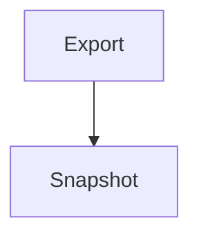

# 导出采样

Markdown 导出 HTML/PDF 计划（2026-10-19）Task 3 的 e2e 采样文档：多级标题（静态
TOC 锚）、围栏代码（复制钮剥离面）、相对图片（导出 data URI 化——像素图二进制由
b-md-export.spec.ts 注入虚拟目录，样例库中无该文件）、外域图片（管线拦截形态），
收起 callout、KaTeX 公式与 mermaid 图（导出内 svg 成品）。
被 apps/web/e2e/b-md-export.spec.ts 以 readFileSync 注入（b-md-syntax 同款通道）。

## 二级标题

段落正文，供 TOC 锚跳与装配断言。

### 三级标题

```rust
fn main() {
    println!("export sampler");
}
```

相对图片（e2e 注入同名像素 PNG，导出后应为 data:image/png 内联）：


外域图片（管线 BUG-17 拦截：无 src + data-vv-blocked-external 标记，导出保持该形态）：


> [!note]- 收起提示
> 收起 callout 的正文，导出后应全部展开可见。

### 公式与图表

质能方程 $E=mc^2$ 与块级公式：

\[ \int_0^1 x^2 \, dx = \frac{1}{3} \]



#### 四级标题

文档末尾标题，实证 TOC 的 l4 层级缩进。
