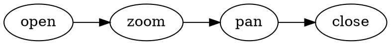

# 灯箱采样

灯箱增强计划（2026-10-19）的画廊样例库：三张不同尺寸 data URI 真图 + 一个 graphviz
围栏（本地 viz-js 引擎渲染 svg 进画廊）。被 apps/web/e2e/b-md-lightbox.spec.ts 以
readFileSync 注入（b-md-diagrams 同款通道）。图均不带宽高属性——collectGallery 只跳
「宽高属性均在且均 <32」的微缩图，不带属性必入画廊，画廊计 4 条（3 img + 1 svg）。

